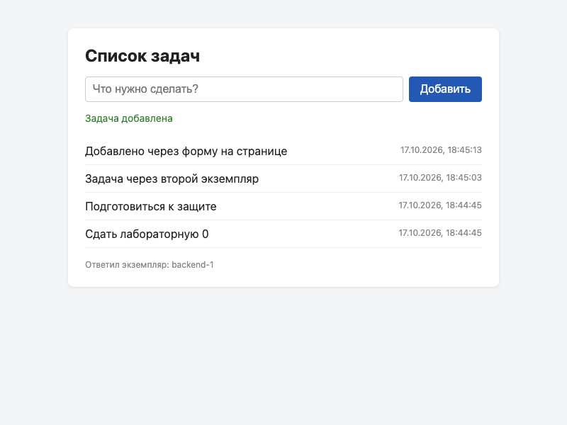
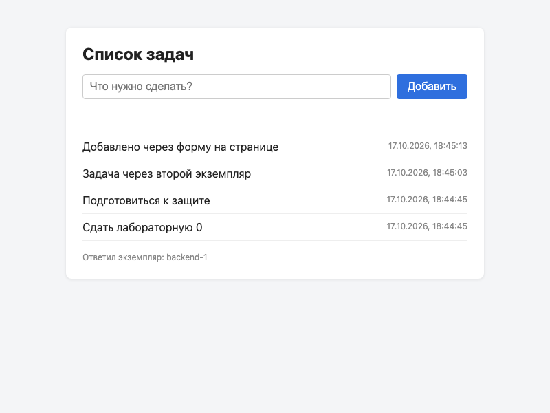

# Отчёт по лабораторной 0

## Что сделано

- **Бэкенд** (`backend/app.py`): Flask + psycopg2. Эндпоинты `GET /api/tasks`, `POST /api/tasks`, `GET /health`. Таблица `tasks` создаётся при старте через `CREATE TABLE IF NOT EXISTS`; если БД при старте была недоступна, таблица создаётся при первом запросе.
- **Фронтенд** (`frontend/`): одна страница с формой и списком, запросы через `fetch` на относительный `/api/tasks`. Внизу страницы показано, какой экземпляр бэкенда ответил.
- **БД**: PostgreSQL 16 (Homebrew) как отдельный сервис на `localhost:5432`, пользователь и база `todo`. Пароль хранится только в локальном `lab-0/.env`, который исключён из git.
- Конфигурация только через переменные окружения (`DB_HOST`, `DB_PORT`, `DB_NAME`, `DB_USER`, `DB_PASSWORD`, `PORT`, `INSTANCE_ID`), бэкенд слушает `0.0.0.0:$PORT`.
- Каждый ответ содержит `instance_id` в JSON и заголовок `X-Instance-Id`.
- Ошибки: пустая задача и не-JSON → `400`, неизвестный путь → `404`, БД недоступна → `503`, всё в JSON.

## Как запустить

Подробно — в [README.md](README.md). Коротко, из папки `lab-0`:

```bash
cp .env.example .env   # вписать пароль от БД
python3 -m venv venv
./venv/bin/pip install -r backend/requirements.txt
set -a; source .env; set +a
./venv/bin/python backend/app.py
```

Страница: http://localhost:8000/

## Проверка через curl

Строки `Server`, `Date` и `Connection` из заголовков убраны для краткости, остальное — как вывел curl.

```text
$ curl -s -i http://localhost:8000/health
HTTP/1.1 200 OK
Content-Type: application/json
Content-Length: 52
X-Instance-Id: backend-1

{"db":"ok","instance_id":"backend-1","status":"ok"}


$ curl -s -i -X POST http://localhost:8000/api/tasks -H 'Content-Type: application/json' -d '{"text": "Проверка через curl"}'
HTTP/1.1 201 CREATED
Content-Type: application/json
Content-Length: 134
X-Instance-Id: backend-1

{"instance_id":"backend-1","task":{"created_at":"2026-10-17T18:45:34.177686+03:00","id":5,"text":"Проверка через curl"}}


$ curl -s -i http://localhost:8000/api/tasks
HTTP/1.1 200 OK
Content-Type: application/json
Content-Length: 601
X-Instance-Id: backend-1

{"instance_id":"backend-1","tasks":[{"created_at":"2026-10-17T18:45:34.177686+03:00","id":5,"text":"Проверка через curl"},{"created_at":"2026-10-17T18:45:13.098124+03:00","id":4,"text":"Добавлено через форму на странице"},{"created_at":"2026-10-17T18:45:03.102791+03:00","id":3,"text":"Задача через второй экземпляр"},{"created_at":"2026-10-17T18:44:45.168093+03:00","id":2,"text":"Подготовиться к защите"},{"created_at":"2026-10-17T18:44:45.150395+03:00","id":1,"text":"Сдать лабораторную 0"}]}


$ curl -s -i -X POST http://localhost:8000/api/tasks -H 'Content-Type: application/json' -d '{"text": "   "}'
HTTP/1.1 400 BAD REQUEST
Content-Type: application/json
Content-Length: 66
X-Instance-Id: backend-1

{"error":"task text must not be empty","instance_id":"backend-1"}


$ curl -s -i -X POST http://localhost:8000/api/tasks -d 'not json'
HTTP/1.1 400 BAD REQUEST
Content-Type: application/json
Content-Length: 82
X-Instance-Id: backend-1

{"error":"expected JSON body like {\"text\": \"...\"}","instance_id":"backend-1"}
```

## Сохранение после перезапуска бэкенда

Задачи 1 и 2 были созданы, затем бэкенд остановлен и запущен заново. Сразу после перезапуска обе задачи вернулись из БД. Параллельно был запущен второй экземпляр (`PORT=8001 INSTANCE_ID=backend-2`): он видит те же задачи, а задача, добавленная через него, видна и через первый экземпляр.

```text
# бэкенд backend-1 перезапущен, backend-2 запущен на 8001
$ curl -s -i http://localhost:8000/api/tasks
HTTP/1.1 200 OK
Content-Type: application/json
Content-Length: 251
X-Instance-Id: backend-1

{"instance_id":"backend-1","tasks":[{"created_at":"2026-10-17T18:44:45.168093+03:00","id":2,"text":"Подготовиться к защите"},{"created_at":"2026-10-17T18:44:45.150395+03:00","id":1,"text":"Сдать лабораторную 0"}]}


$ curl -s -i http://localhost:8001/api/tasks
HTTP/1.1 200 OK
Content-Type: application/json
Content-Length: 251
X-Instance-Id: backend-2

{"instance_id":"backend-2","tasks":[{"created_at":"2026-10-17T18:44:45.168093+03:00","id":2,"text":"Подготовиться к защите"},{"created_at":"2026-10-17T18:44:45.150395+03:00","id":1,"text":"Сдать лабораторную 0"}]}


$ curl -s -i -X POST http://localhost:8001/api/tasks -H "Content-Type: application/json" -d "{\"text\": \"Задача через второй экземпляр\"}"
HTTP/1.1 201 CREATED
Content-Type: application/json
Content-Length: 157
X-Instance-Id: backend-2

{"instance_id":"backend-2","task":{"created_at":"2026-10-17T18:45:03.102791+03:00","id":3,"text":"Задача через второй экземпляр"}}


$ curl -s http://localhost:8000/api/tasks
{"instance_id":"backend-1","tasks":[{"created_at":"2026-10-17T18:45:03.102791+03:00","id":3,"text":"Задача через второй экземпляр"},{"created_at":"2026-10-17T18:44:45.168093+03:00","id":2,"text":"Подготовиться к защите"},{"created_at":"2026-10-17T18:44:45.150395+03:00","id":1,"text":"Сдать лабораторную 0"}]}


$ curl -s -i http://localhost:8000/api/nope
HTTP/1.1 404 NOT FOUND
Content-Type: application/json
Content-Length: 48
X-Instance-Id: backend-1

{"error":"not found","instance_id":"backend-1"}
```

## Поведение при недоступной БД

PostgreSQL остановлен (`brew services stop postgresql@16`) при работающем бэкенде, затем запущен снова. Бэкенд не упал и отвечал понятным JSON с кодом 503.

```text
$ brew services stop postgresql@16

$ curl -s -i http://localhost:8000/health
HTTP/1.1 503 SERVICE UNAVAILABLE
Content-Type: application/json
Content-Length: 64
X-Instance-Id: backend-1

{"db":"unavailable","instance_id":"backend-1","status":"error"}


$ curl -s -i http://localhost:8000/api/tasks
HTTP/1.1 503 SERVICE UNAVAILABLE
Content-Type: application/json
Content-Length: 59
X-Instance-Id: backend-1

{"error":"database unavailable","instance_id":"backend-1"}


$ curl -s -i -X POST http://localhost:8000/api/tasks -H "Content-Type: application/json" -d "{\"text\": \"при выключенной БД\"}"
HTTP/1.1 503 SERVICE UNAVAILABLE
Content-Type: application/json
Content-Length: 59
X-Instance-Id: backend-1

{"error":"database unavailable","instance_id":"backend-1"}


$ brew services start postgresql@16

$ curl -s -i http://localhost:8000/health
HTTP/1.1 200 OK
Content-Type: application/json
Content-Length: 52
X-Instance-Id: backend-1

{"db":"ok","instance_id":"backend-1","status":"ok"}
```

## Данные в самой базе

```text
$ psql -h localhost -U todo -d todo -c '\d tasks' -c 'SELECT id, text FROM tasks ORDER BY id;'
Таблица "public.tasks"
  Столбец   |           Тип            | Правило сортировки | Допустимость NULL |           По умолчанию            
------------+--------------------------+--------------------+-------------------+-----------------------------------
 id         | integer                  |                    | not null          | nextval('tasks_id_seq'::regclass)
 text       | text                     |                    | not null          | 
 created_at | timestamp with time zone |                    | not null          | now()
Индексы:
    "tasks_pkey" PRIMARY KEY, btree (id)

 id |               text                
----+-----------------------------------
  1 | Сдать лабораторную 0
  2 | Подготовиться к защите
  3 | Задача через второй экземпляр
  4 | Добавлено через форму на странице
  5 | Проверка через curl
(5 строк)
```

## Скриншоты

Сделаны автоматически через Playwright (headless Chromium): страница открыта, задача добавлена через форму, затем страница перезагружена.

| После добавления | После перезагрузки |
|---|---|
|  |  |

## Что проверено

- [x] `GET /health` → 200 при работающей БД, 503 при остановленной
- [x] `POST /api/tasks` → 201, задача записана в PostgreSQL
- [x] `GET /api/tasks` → 200, новые задачи сверху
- [x] пустая задача и тело не в JSON → 400 с понятным сообщением
- [x] БД недоступна → 503 вместо падения, после запуска БД всё снова работает
- [x] `instance_id` в JSON и `X-Instance-Id` в заголовках
- [x] два экземпляра на портах 8000 и 8001 одновременно, с общей БД
- [x] задачи сохраняются после перезапуска бэкенда и перезагрузки страницы
- [x] пароль от БД не попал в репозиторий (`.env` в `.gitignore`)

## Что не удалось проверить или что стоит учесть

- Всё проверялось только на macOS (Apple Silicon, Python 3.12, PostgreSQL 16). На Linux и Windows не запускалось.
- Порт 5000 на macOS занят AirPlay Receiver (первый запуск на 5000 упал с «Address already in use»), поэтому порт по умолчанию — 8000.
- Бэкенд работает на встроенном dev-сервере Flask (он сам об этом предупреждает в логе). Для лабы 0 этого достаточно.
- Первый прогон curl отдавал кириллицу как `\uXXXX`-последовательности. Это корректный JSON, но плохо читается, поэтому добавлена настройка `app.json.ensure_ascii = False` и проверки повторены; выше приведён вывод уже после неё.
